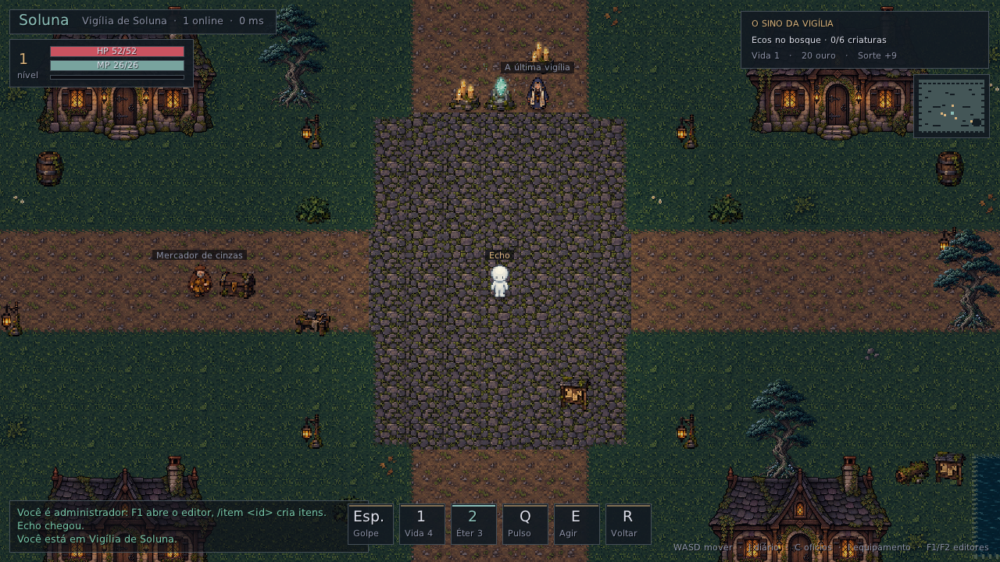
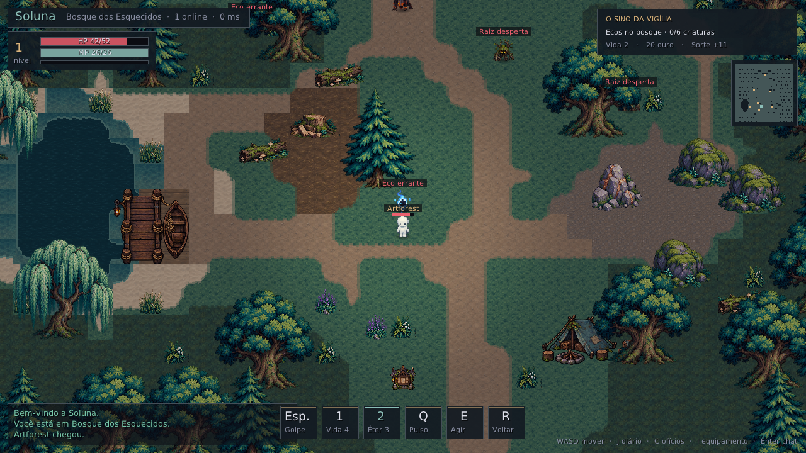
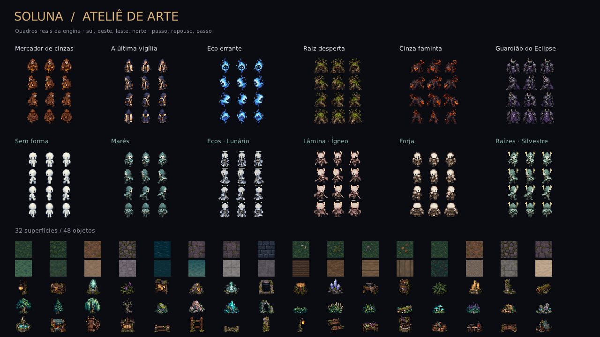

# Soluna — engine e jogo de exemplo

Soluna é uma **engine 2D de RPG online**, em C# / .NET 10, com cliente MonoGame, servidor autoritativo e editores dentro do jogo. O repositório também inclui **Soluna**, um jogo-modelo de fantasia medieval sombria, com visão de cima, exploração roguelike e evolução guiada pelas ações do personagem.

**Estado atual: base jogável em desenvolvimento.** Já é possível entrar com vários clientes, explorar, combater, praticar ofícios, fabricar equipamentos, transformar o personagem e renascer. O projeto ainda precisa de trabalho para operar como um MMORPG público em grande escala.

## O que a engine já oferece

| Área | Implementação atual |
| --- | --- |
| Cliente e mundo | MonoGame DesktopGL, mapas em camadas, grade de 32 × 32, movimento entre tiles com interpolação, câmera, zoom, iluminação e objetos ordenados por profundidade. |
| Rede e simulação | Servidor UDP com LiteNetLib, atualização a 20 Hz, validação de movimento, combate, distância de interação, intervalos entre ações e custos das receitas. |
| Contas e persistência | Cadastro, login, até três personagens por conta, uma sessão por conta e salvamento em arquivos JSON. Senhas armazenadas como hashes PBKDF2 com salt. |
| Combate e personagens | Vida, essência, nível, experiência, inventário, equipamentos, NPCs amigáveis e hostis, perseguição, ataques, morte e reaparecimento. Suporte a PvP conforme a configuração do mapa. |
| Autoria dentro do jogo | Editor de mapas em F1; editor de itens e NPCs em F2; importação de PNG ao arrastar para a janela; importação de mapas Tiled pelo servidor. Edição restrita a administradores. |
| Conteúdo e sincronização | Mapas, itens, NPCs e assets por jogo; distribuição de arquivos aos clientes e cache de mapas por revisão. |
| Sistemas de aventura | Hábitos, formas emergentes, memórias da conta, sorte, atividades, receitas e geração de ruínas. Receitas e regras de evolução são configuradas por jogo em JSON. |
| Vários jogos | Cada projeto vive em `games/<nome>`, com seleção por `--game` e criação a partir de outro jogo com `--new-game`. |

Os editores existentes cobrem mapas, itens e NPCs. Receitas, evolução e pontos de atividade ainda exigem edição dos arquivos de dados. Parte da lógica específica de Soluna, como objetivos, ofertas do mercador e influências ambientais da sorte, permanece no código; a separação entre engine e jogo ainda está em evolução.

## O jogo-modelo Soluna

### Uma forma construída pela vida

Cada personagem começa como uma figura clara, neutra, sem escolher classe, raça ou aparência. Lutar, pescar, explorar, coletar, fabricar, consumir e conquistar deixa vestígios. Combinações desses hábitos podem mudar sua especialização, origem e apresentação visual durante a vida.

O conteúdo atual tem **seis especializações e três origens**, que representam os caminhos de classe e sub-raça do exemplo. As transformações são descobertas pela prática, sem um menu de seleção ou exposição dos requisitos. Um espadachim continua podendo pescar, minerar e fabricar; a forma não bloqueia essas atividades. Mudanças persistentes nos hábitos podem levar a outra especialização.

Na morte, nível, experiência, forma, hábitos, inventário e recursos da vida atual voltam ao estado inicial. Memórias, conquistas registradas e totais da conta permanecem. Esses registros concedem pequenos benefícios nas próximas vidas; a progressão persistente atual se concentra nessas memórias e na afinidade natural com a sorte.

### Mundo, combate e ruínas

- **Vigília de Soluna:** vila com mercador, bancada, santuário e quadro de objetivos.
- **Bosque dos Esquecidos:** área de exploração, combate, fontes de materiais e acesso às ruínas.
- **Ruínas do Eclipse:** salas e corredores procedurais, relicários, extração de essência e descida liberada após derrotar os inimigos do andar.
- **Combate:** golpe corpo a corpo, pulso de essência em área, equipamentos, consumíveis e recompensas por derrotar criaturas. O Guardião do Eclipse aparece a cada terceiro andar.

As ruínas não têm um último andar definido no conteúdo. A dificuldade aumenta com a profundidade, dentro dos limites numéricos da implementação. Uma nova expedição muda a semente quando não há jogadores nas ruínas. Os jogadores compartilham a expedição ativa; instâncias privadas por grupo ainda não existem. Semente e mapas são salvos, mas as criaturas reaparecem ao reiniciar o servidor.

### Ofícios, fabricação e sorte

Há **cinco atividades**: pesca, coleta de plantas (*gathering*), mineração (*mining*), corte de madeira (*woodcutting*) e extração de essência (*extraction*). Elas funcionam em pontos de interação do mapa, com distância e intervalo entre tentativas verificados pelo servidor.

Os seis materiais do exemplo alimentam **nove receitas** de consumíveis, lingotes e equipamentos. A fabricação exige uma bancada. O mercador vende provisões e uma lâmina inicial; a venda de excedentes preserva dez unidades de cada material para uso posterior.

A **sorte é variável**: soma a marca natural da conta, o ciclo dos espíritos, o ambiente, memórias, equipamentos, bênçãos, maldições e consumíveis. Ela afeta quantidades coletadas e chances de recompensas raras. O caderno mostra as influências ativas; bênçãos, chá e maldições têm duração limitada.

### Visual atual

O exemplo usa 16 superfícies e 16 objetos de cenário, com transições entre grama, caminhos e água. Criaturas, habitantes da vila e formas evoluídas têm folhas próprias de animação; a entrada das ruínas também recebeu um novo cenário. O personagem inicial conserva a aparência neutra e o tamanho genérico. As cores e marcas das formas evoluídas acompanham a gameplay.

A direção é fantasia sombria com sprites em pixels, acompanhada de arte de abertura, HUD, minimapa e caderno de vestígios. As referências de atmosfera e apresentação incluem Moonlighter, Crystalshire e RPGs top-down. O inventário de assets e o formato de importação estão nos [créditos e documentação de arte](games/soluna/assets/SOLUNA_ART.md). Para inspecionar todos os quadros dentro do cliente, sem servidor, execute `dotnet run --project src/Soluna.Client -- --art-preview`.

As capturas abaixo são do cliente em execução com a arte atual incluída neste repositório.

**Vigília de Soluna — cenário, habitantes e personagem inicial neutro**



**Bosque dos Esquecidos — exploração, criaturas e pontos de coleta**



**Prévia na engine — animações, formas emergentes, tiles e objetos**



## Executar localmente

Requer **.NET 10 SDK**. O cliente é uma aplicação desktop. No Linux, precisa de SDL2, OpenGL/Mesa, OpenAL e uma fonte disponível, como DejaVu; também é possível fornecer uma fonte `.ttf` em `games/soluna/assets/fonts/`. A validação atual foi feita em Linux com .NET SDK 10.0.401.

Na raiz do repositório:

```bash
dotnet restore Soluna.slnx
dotnet build Soluna.slnx --no-restore
```

Inicie o servidor em um terminal:

```bash
dotnet run --project src/Soluna.Server --no-build
```

Em outro terminal, abra o cliente:

```bash
dotnet run --project src/Soluna.Client --no-build
```

O destino padrão é `127.0.0.1`, porta **UDP 7171**. Crie uma conta na tela de entrada e dê um nome ao personagem. A primeira conta criada em um servidor novo recebe acesso de administrador aos editores. Abra outro cliente com outra conta para jogar em conjunto.

O cliente aceita `--host`, `--port` e `--game`. Para usar outra porta local:

```bash
dotnet run --project src/Soluna.Server --no-build -- 7172
dotnet run --project src/Soluna.Client --no-build -- --host 127.0.0.1 --port 7172
```

Execute esses dois comandos em terminais separados. Cliente e servidor precisam usar a mesma versão do protocolo. Encerre o servidor com **Ctrl+C** para salvar os personagens.

### Ambiente de nuvem preparado

No ambiente configurado para este projeto, ative as ferramentas em cada terminal antes dos comandos acima:

```bash
cd /workspace/soluna
source /workspace/.soluna-setup/activate.sh
```

A ativação aponta `SOLUNA_ROOT` para `/workspace/.soluna-setup/game`: o mundo usado em execução fica fora do checkout. Alterações em `games/soluna` no repositório precisam ser incorporadas à cópia de execução para aparecer nesse ambiente, preservando contas, conteúdo privado e edições existentes. Os processos de cliente e servidor precisam ser iniciados novamente após restaurar o ambiente.

## Controles e primeiros passos

| Ação | Controle |
| --- | --- |
| Andar | WASD / setas |
| Golpear | Espaço / Ctrl esquerdo |
| Pulso de essência | Q |
| Interagir, coletar ou usar uma passagem | E perto do ponto |
| Usar tônico / éter | 1 / 2 |
| Caderno: vida, ofícios, trocas e memórias | J |
| Abrir receitas | C; fabricar exige proximidade de uma bancada |
| Equipamento | I |
| Retornar à vila | R, após sete segundos fora de combate |
| Conversar | Enter |
| Editor de mapas / itens e NPCs | F1 / F2, administrador |
| Alternar iluminação | F3 |
| Zoom | + / - |

Na vila, procure o santuário ao norte da praça e a bancada a oeste. A passagem norte leva ao bosque. Use E nos pontos de recursos, volte à bancada para fabricar e consulte o caderno para acompanhar provisões e mudanças. O quadro da vila reconhece objetivos de caça e a derrota do guardião. A entrada das ruínas fica ao norte do bosque.

## Criar outro jogo com a engine

Crie uma cópia do conteúdo compartilhável do exemplo:

```bash
dotnet run --project src/Soluna.Server -- --new-game meu_mundo --from soluna
```

Depois, em terminais separados:

```bash
dotnet run --project src/Soluna.Server -- --game meu_mundo
dotnet run --project src/Soluna.Client -- --game meu_mundo
```

A cópia exclui contas e pastas `private`. `SOLUNA_GAME` define o jogo padrão; `SOLUNA_ROOT` define a raiz que contém `games/`. Sem essa variável, a engine procura a raiz do repositório e usa seus arquivos de jogo diretamente.

| Local | Responsabilidade |
| --- | --- |
| `src/Soluna.Shared` | Protocolo, formatos, fórmulas, evolução, sorte e geração procedural. |
| `src/Soluna.Server` | Contas, persistência, simulação, combate, ofícios e distribuição de conteúdo. |
| `src/Soluna.Client` | Renderização, entrada, interface, sincronização e editores. |
| `games/<nome>/data/adventure.json` | Atividades, materiais, receitas, ruínas e opções de aparência emergente e renascimento. |
| `games/<nome>/data/evolution.json` | Regras de hábitos, especializações, origens, cores, silhuetas e bônus. |
| `games/<nome>/data/items.json`, `npcs.json`, `maps/` | Equipamentos, criaturas, mapas, portais, colisões e pontos de interação. |
| `games/<nome>/assets/` | Sprites, tilesets, objetos de cenário, fontes e créditos. |
| `games/<nome>/data/accounts/` | Contas e personagens persistidos; ignorados pelo Git. |
| `tests/Soluna.Tests` | Verificações de regras, geração e integração por UDP. |
| `tools/` | Geradores e importadores de conteúdo. |

Consulte [Engine e jogo de exemplo](docs/SOLUNA_ENGINE.md) para os formatos e regras. `tools/configure_soluna_art.py` recria os metadados de importação das páginas de arte incluídas; `tools/build_soluna_art.py` reproduz as folhas de fallback. `tools/build_soluna_world.py` recria mapas e dados do exemplo; `--maps-only` restringe a recriação aos dois mapas públicos. Essas ferramentas sobrescrevem seus arquivos de saída e só devem ser usadas ao regenerar esse conteúdo deliberadamente. Não são necessárias para jogar.

## Testes e validação

A partir da raiz do repositório:

```bash
dotnet build Soluna.slnx
dotnet run --project tests/Soluna.Tests
```

O projeto de testes é um executor de console: retorna código diferente de zero se alguma verificação falhar. Cria um mundo temporário e contas descartáveis, abre seu próprio servidor em uma porta UDP local disponível e não depende do servidor de jogo em execução.

A última validação desta implementação terminou com **27 testes aprovados, nenhuma falha e build sem avisos ou erros**. A cobertura inclui evolução por hábitos, combinações de ações, sorte, receitas, profissões, permissões, persistência, combate, cooldown, descida, renascimento e referências dos quadros de arte. A geração foi verificada em **80 combinações de semente e profundidade**. O cliente também foi executado e inspecionado com Xvfb e Mesa.

Para verificar o cliente sem monitor no Linux, com o servidor já iniciado e Xvfb instalado:

```bash
LIBGL_ALWAYS_SOFTWARE=1 ALSOFT_DRIVERS=null xvfb-run -a \
  dotnet run --project src/Soluna.Client -- \
  --walk --name Smoke --journal --screenshot /tmp/soluna-smoke.png
```

O modo `--walk --name` usa uma conta local de teste, entra no mundo e movimenta o personagem. `--journal` abre o caderno; `--screenshot` salva a imagem e encerra o cliente. Use essas opções para inspeção de desenvolvimento.

## Limites e trabalho restante

- **Operação de MMO:** foram validados clientes locais; capacidade de carga, hospedagem pública, moderação e operação contínua ainda precisam ser desenvolvidas e verificadas.
- **Segurança de transporte:** as senhas são armazenadas com hash, mas o protocolo atual envia o login sem criptografia. A execução atual é destinada a uma rede de desenvolvimento confiável.
- **Autoria completa:** faltam editores visuais para as novas regras de evolução, receitas e atividades, além de maior separação das regras específicas do exemplo no código.
- **Expedições:** ainda são compartilhadas entre jogadores; não há instâncias por grupo, e o estado das criaturas não sobrevive ao reinício do servidor.
- **Conteúdo e acabamento:** áudio, variedade de cenários e habilidades, balanceamento prolongado e refinamento da apresentação continuam em desenvolvimento.

Este README descreve o estado atual. [Engine base](docs/ENGINE_BASE.md) preserva o README anterior como referência histórica dos editores e importadores; descrições do jogo e planos antigos ali não substituem este documento.

## Licença e créditos

Código sob [licença MIT](LICENSE). A arquitetura foi inspirada em [Crystalshire](https://github.com/RobinPerris/Crystalshire), de Robin Perris. O cliente e a rede usam [MonoGame](https://monogame.net), [LiteNetLib](https://github.com/RevenantX/LiteNetLib) e [FontStashSharp](https://github.com/FontStashSharp/FontStashSharp).

A arte nova e sua origem estão nos [créditos de Soluna](games/soluna/assets/SOLUNA_ART.md). Os conjuntos anteriores LPC e BoundWorlds/chibi mantêm seus créditos e licenças próprios; veja também a [documentação dos assets](games/soluna/assets/README.md).
